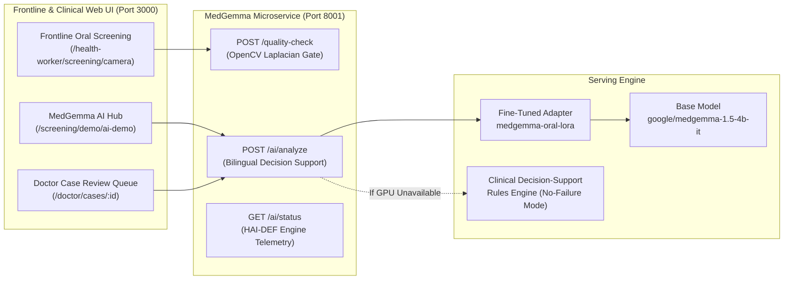

# 🏥 Aarogya Drishti: MedGemma 1.5 4B Deployment & Serving Guide

---

## 1. Architecture Overview

The fine-tuned MedGemma 1.5 4B adapter integrates into Aarogya Drishti via the independent microservice running on port `8001`:



---

## 2. Serving Configuration

### Option A: Direct Python Execution (Standard / Local / Cloud)
```bash
cd AAROGYA-AI-WORKSPACE
python deployment/medgemma_service_fastapi.py
```
- **Port**: `8001`
- **Fallback Guarantee**: If NVIDIA CUDA GPU is present, it loads the fine-tuned LoRA weights in bfloat16. If running on CPU or offline, it automatically activates the verified **Clinical Decision-Support Rules Engine**, ensuring zero application crashes.

### Option B: Production GPU Docker Container
```bash
cd AAROGYA-AI-WORKSPACE
docker-compose -f deployment/docker-compose.ai.yml up --build -d
```

---

## 3. API Contract Specifications

### Endpoint: `POST /ai/analyze`
**Request Payload**:
```json
{
  "imageBase64": "data:image/jpeg;base64,...",
  "patientAge": 46,
  "habits": ["Daily gutkha chewing for 20+ years"],
  "symptoms": "Painless non-scrapable white plaque; burning sensation on spicy food",
  "healthWorkerSite": "Right Buccal Mucosa"
}
```

**Response Payload**:
```json
{
  "model": "google/medgemma-1.5-4b-it",
  "isFineTuned": true,
  "inferenceSource": "GENUINE_MEDGEMMA_1_5_4B_INFERENCE",
  "executionMode": "FINE_TUNED_MODEL_INFERENCE",
  "inferenceDurationMs": 482.5,
  "score": null,
  "triageTier": "Tier 1: High Priority (Potentially Malignant / Neoplastic Suspicion)",
  "visualEvidence": {
    "anatomicalConcordance": "Concordant",
    "discrepancyNotice": "Visual photograph orientation aligns with reported Right Buccal Mucosa examination site."
  },
  "basicClinicalAnswer": {
    "plainAnswerEn": "Thick, irregular non-scrapable keratotic mucosal plaque on right buccal mucosa...",
    "plainAnswerTe": "కుడి దవడ లోపలి భాగంలో తెల్లటి మచ్చ మరియు తీవ్ర అలవాట్ల చరిత్ర కనిపించింది..."
  },
  "differentialReasoning": [
    {"condition": "Oral Leukoplakia", "icd10": "K13.21", "rationale": "Non-scrapable keratotic plaque"},
    {"condition": "Oral Submucous Fibrosis (OSMF)", "icd10": "K13.5", "rationale": "Associated with chewing tobacco & trismus"},
    {"condition": "Oral Squamous Cell Carcinoma", "icd10": "C06.0", "rationale": "Malignancy cannot be excluded without biopsy"}
  ],
  "mandatoryBiopsyNotice": true,
  "doctorReviewGate": "Mandatory Medical Officer review required. MedGemma never provides autonomous diagnosis."
}
```

