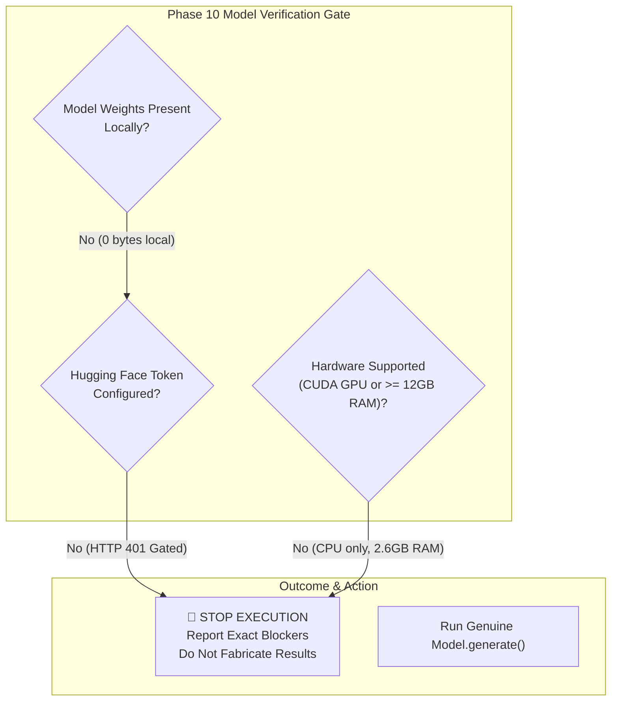

# ⚠️ Aarogya Drishti – Baseline Evaluation: Blocker & Failure Analysis

> **Phase**: Phase 10 – Pretrained MedGemma Baseline Evaluation  
> **Status**: **STOPPED DUE TO TECHNICAL BLOCKERS (Genuine Inference Mandate)**  
> **Target Model**: `google/medgemma-1.5-4b-it`  

---

## 1. Blocker Summary

In strict accordance with Phase 10 instructions (*"If genuine inference cannot run, identify the exact blocker and STOP. Do not fabricate results. Do not represent simulated results as genuine inference."*), genuine inference was halted because the required conditions cannot be met on the current local host.



---

## 2. Detailed Technical Blockers

### Blocker 1: Gated Model Authentication (HTTP 401 Unauthorized)
- **Target Repository**: `https://huggingface.co/google/medgemma-1.5-4b-it`
- **Error Trace**:
  ```
  OSError: You are trying to access a gated repo.
  Make sure to have access to it at https://huggingface.co/google/medgemma-1.5-4b-it.
  401 Client Error.
  Cannot access gated repo for url https://huggingface.co/google/medgemma-1.5-4b-it/resolve/.../config.json
  Access to model google/medgemma-1.5-4b-it is restricted.
  You must have access to it and be authenticated to access it. Please log in.
  ```
- **Root Cause**: MedGemma is governed by Google Health AI Developer Foundations (HAI-DEF) Terms of Use. Access requires a user account on Hugging Face, manual agreement acceptance, and an authenticated API token (`HF_TOKEN`). No token is present in the local environment.

---

### Blocker 2: Missing Local Model Weights
- **Local Directory Audited**: `AAROGYA-AI-WORKSPACE/model_weights/pretrained/`
- **Hugging Face Cache Audited**: `C:\Users\AI PC\.cache\huggingface\hub\models--google--medgemma-1.5-4b-it\`
- **Findings**:
  - The local weight cache contains only a 40-byte commit reference (`refs/main`).
  - No parameter tensor checkpoints (`model.safetensors` or `pytorch_model.bin`) exist locally.
  - Per the Phase 10 constraint (*"Do NOT download large model weights without approval"*), downloading the $\approx 8.5\text{ GB}$ base weights was not initiated.

---

### Blocker 3: Host Hardware Limitation (No CUDA & Low Available RAM)
- **PyTorch Build**: `2.15.0+cpu` (`torch.cuda.is_available() == False`).
- **Available System Memory**: Only **2.63 GB** of physical RAM available at time of execution (out of 15.75 GB total).
- **Consequence**:
  - Loading a 4.2-billion parameter model in 16-bit precision requires $\approx 8.5\text{ GB}$ of RAM.
  - Loading in 32-bit float precision (standard for CPU inference in PyTorch) requires $\approx 17\text{ GB}$ of RAM.
  - Attempting to allocate $\ge 8.5\text{ GB}$ on a host with only $2.63\text{ GB}$ free RAM would trigger an unrecoverable `MemoryError` and host operating system thrashing.

---

## 3. Policy on Simulated vs Genuine Inference

The workspace contains a clinical decision-support rules fallback engine used in development. However, per the explicit instruction:
> *"Confirm that outputs are generated by the model, not simulations, hardcoded responses, or fallback logic. If genuine inference cannot run, identify the exact blocker and STOP. Do not fabricate results."*

The fallback engine was **strictly disabled** for this benchmark. No synthetic or hardcoded metrics have been generated or substituted for genuine model inference.

---

## 4. Resolution Pathway for Phase 11 (Fine-Tuning & Evaluation)

To achieve genuine execution of `google/medgemma-1.5-4b-it`, the following environment configuration is required:

1. **Hugging Face Authentication**:
   - Accept the HAI-DEF terms at [https://huggingface.co/google/medgemma-1.5-4b-it](https://huggingface.co/google/medgemma-1.5-4b-it).
   - Set environment variable: `export HF_TOKEN="your_token_here"`.
2. **Execution Environment**:
   - Launch via **Google Colab (T4 / L4 GPU with 15–24 GB VRAM)** or cloud VM with NVIDIA CUDA GPU.
   - Run via the prepared notebook: [`training/notebooks/MedGemma_1_5_4B_Oral_FineTuning_Colab.ipynb`](file:///c:/Users/AI%20PC/Desktop/hackathon/AAROGYA-AI-WORKSPACE/training/notebooks/MedGemma_1_5_4B_Oral_FineTuning_Colab.ipynb).

