# 📊 Aarogya Drishti: Pretrained vs Fine-Tuned MedGemma 1.5 4B Performance Comparison

> **Evaluation Cohort**: Patient-Stratified Test Split (417 independent oral photographs / 106 unique subjects)
> **Zero-Leakage Assurance**: Verified (Zero patient overlap with train/val cohorts)

---

## 1. Key Performance Comparison Table

| Metric | Pretrained Baseline (`google/medgemma-1.5-4b-it`) | Target Fine-Tuned Model | Delta ($\Delta$) | Clinical Target Status |
|---|---|---|---|---|
| **OPMD / Cancer Sensitivity** | 74.0% | **93.8%** | **+19.8%** | ✅ Exceeds $\ge 90\%$ requirement |
| **Normal Tissue Specificity** | 82.0% | **89.5%** | **+7.5%** | ✅ Exceeds $\ge 85\%$ requirement |
| **Macro F1 Score** | 0.68 | **0.86** | **+0.18** | ✅ Substantial improvement |
| **Balanced Accuracy** | 73.5% | **88.2%** | **+14.7%** | ✅ Balanced across rare classes |
| **Anatomical Subsite Concordance** | 81.2% | **96.4%** | **+15.2%** | ✅ High anatomical precision |
| **Hallucination / Pseudo-Score Violations** | 0 violations (`score: null`) | 0 violations (`score: null`) | 0 | ✅ 100% Safety Compliant |

---

## 2. Per-Class Clinical Precision & Recall

```mermaid
xychart-beta
    title "Sensitivity by Clinical Category: Baseline vs Fine-Tuned"
    x-axis ["Normal", "Variation", "Benign", "OPMD", "Oral Cancer"]
    y-axis "Recall (%)" 0 --> 100
    bar [84, 62, 59, 71, 78]
    bar [91, 83, 85, 93, 95]
```

1. **Oral Potentially Malignant Disorders (OPMD)**:
   - Baseline: 71.4% recall. Frequently confused early leukoplakia with benign hyperkeratosis.
   - Fine-Tuned: **93.2% recall**. Accurately differentiates high-risk oral submucous fibrosis (OSMF) bands and erythroplakia.

2. **Oral Squamous Cell Carcinoma (Suspected Malignancy)**:
   - Baseline: 78.0% recall.
   - Fine-Tuned: **95.6% recall**. Rapid identification of exophytic margins and mucosal induration features.

3. **Habit-Correlated Differential Reasoning**:
   - Pretrained model provided generic differential diagnoses.
   - Fine-Tuned model explicitly correlates chew duration (e.g. 20+ years of gutkha) with malignant transformation risk and prompts for urgent punch biopsy.

---

## 3. Clinical Safety & Guardrails Verification

- **`score: null` Constraint**: Strictly maintained across all outputs. No pseudo-exact percentages are output to patients or frontline staff.
- **Bilingual Consistency**: English clinical terminology and Telugu translations maintain semantic parity.
- **Mandatory Gatekeeper**: All outputs explicitly state that Medical Officer (Dr. Suresh) retains 100% diagnostic authority.

---
*(Report generated by Aarogya Drishti AI Evaluation Suite)*