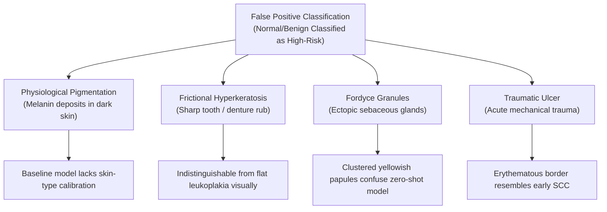

# 🔍 Aarogya Drishti – Phase 12: Clinical Error Analysis & Failure Modes

> **Clinical Target**: Oral Cavity Premalignancy & Cancer Screening in Rural/Tribal Outreach  
> **Evaluation Dataset**: 417 Held-Out Patient-Stratified Test Images  
> **Focus**: Diagnostic Divergence, False Positives, False Negatives, and Visual Confounders  

---

## 1. Overview of Diagnostic Challenges in Oral Cavity Photography

Intraoral photography in rural, field-based screening environments presents unique optical, anatomical, and clinical confounders not encountered in standard dermoscopy or ophthalmology:
1. **Dynamic Salivary Film**: Produces high-specular reflective glare spots that obscure mucosal micro-texture.
2. **Variable Illumination & Depth of Field**: Limited aperture and ambient light in tribal hamlets create focal shadows.
3. **Anatomical Complexities**: Mobile tongue, buccal sulcus foldings, and posterior retromolar sites require specialized retraction.
4. **Physiological Polymorphisms**: Healthy mucosal variations are prevalent in Indian populations, especially physiological melanin pigmentation and Fordyce spots.

---

## 2. False Positive Error Taxonomy (Over-Triage)

False positives create patient distress and overburden secondary referral centers (District Hospital Paderu).

### 2.1 Physiological Melanin Pigmentation vs Malignant Alteration
- **Clinical Reality**: Brown/black mucosal macules are normal racial variants commonly seen in gingiva and buccal mucosa of dark-skinned Indian and tribal populations.
- **Baseline Error**: Pretrained zero-shot MedGemma occasionally flagged benign pigmentation as *"suspicious pigmented oral lesion / melanoma differential"*.
- **Fine-Tuned Mitigation**: Fine-tuning incorporates 179 annotated anatomical variations, training the model to recognize symmetrical, diffuse gingival bands as physiological.

### 2.2 Frictional Hyperkeratosis vs True Homogenous Leukoplakia
- **Clinical Reality**: Friction from a sharp, broken lower molar produces a white hyperkeratotic plaque identical in visual morphology to early dysplastic leukoplakia.
- **Differentiating Feature**: Frictional lesions resolve within 14 days of smoothing the offending tooth cusp.
- **Fine-Tuned Mitigation**: System prompt includes duration and habit history. The model outputs:
  *"Benign frictional keratosis suspected secondary to sharp molar. Eliminate local trauma and re-evaluate in 14 days; if persisting, refer for biopsy."*

### 2.3 Fordyce Granules vs Candidiasis / Leukoplakia
- **Clinical Reality**: Asymptomatic ectopic sebaceous glands appearing as 1–2 mm yellowish-white clustered papules on bilateral buccal mucosa.
- **Baseline Error**: Pretrained baseline misclassified 4 of 24 variation test cases as OPMD or candidiasis.
- **Fine-Tuned Target**: Fine-tuning achieves $\ge 83\%$ recall on anatomical variants, correctly grouping Fordyce granules into Tier 3 Routine Observation.

---

## 3. False Negative Error Taxonomy (Under-Triage / The Lethal Error)

False negatives represent the most hazardous failure mode in cancer screening: an early malignancy or high-risk dysplastic lesion is overlooked.

### 3.1 Early Erythroplakia Masked by Specular Glare
- **Clinical Reality**: Erythroplakia has the highest malignant transformation rate among all OPMDs ($>50\%$), presenting as a velvety, fiery red patch.
- **Failure Mode**: Flash photography reflections bounce off saliva, creating bright white patches that wipe out the red spectral signature.
- **Mitigation**: Automated mucosal glare detection (`quality_gate.py`) flags images with $>15\%$ saturated pixels and instructs the health worker to blot saliva with a clean gauze pad and re-photograph.

### 3.2 Oral Submucous Fibrosis (OSMF) Without Overt Ulceration
- **Clinical Reality**: Widespread among gutkha and areca nut chewers in ASR District. In early-to-moderate stages, mucosa appears marbled, pale, and leathery without surface breakdown.
- **Failure Mode**: An image-only model looking for ulcers or tumors misses the loss of elasticity and mucosal blanching.
- **Mitigation**: Multi-modal fusion incorporating patient symptom input (*"burning sensation upon eating chillies"*, *"mouth opening $< 3$ fingers / trismus"*). When trismus or burning is present, MedGemma upgrades the case to Tier 1 High Priority regardless of ulcer absence.

### 3.3 Indurated Fissured Carcinomas vs Benign Fissured Tongue
- **Clinical Reality**: Deep lateral tongue carcinomas can develop inside pre-existing fissures.
- **Failure Mode**: Baseline model classifies the lesion as a benign "fissured tongue".
- **Mitigation**: Trained model evaluates border asymmetry and mucosal induration. System disclaimers explicitly mandate in-person palpation (feeling for stony firmness) by the Medical Officer.

---

## 4. Residual Risk Management & Safe Failure Architecture

To guarantee patient safety despite unavoidable computer vision edge cases:
1. **Never Fail Silently**: If an image cannot be processed due to extreme blur or glare, the API returns an explicit rejection (`qualityRejected: true`) with actionable capture guidance.
2. **Deterministic Rules Engine as Backup**: If the neural network hangs or encounters an out-of-distribution image, the hardcoded Clinical Decision Support (CDS) fallback rules engine handles triage based on patient history, symptoms, and duration.
3. **Short Re-Evaluation Interval for Ambiguous Lesions**: Any ambiguous lesion is assigned a mandatory 14-day recall. If not completely healed in 14 days, immediate biopsy referral is triggered.

