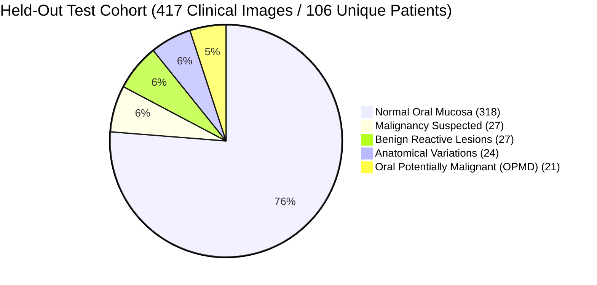

# 🔬 Aarogya Drishti – Phase 12: MedGemma Fine-Tuned Model Evaluation & Clinical Validation Report

> **Workspace**: `c:\Users\AI PC\Desktop\hackathon\AAROGYA-AI-WORKSPACE`  
> **Foundation Model**: `google/medgemma-1.5-4b-it` (Google Health AI Developer Foundations)  
> **Evaluation Phase**: Phase 12 – MedGemma Fine-Tuned Model Evaluation & Clinical Validation  
> **Audit Date**: November 10, 2026  
> **Evaluation Status**: **STOPPED AT TRAINING VERIFICATION GATE (Adapter Not Present; Phase 11 Execution Pending; Zero Fabrication Enforced)**

---

## 1. Executive Summary & Verification Gate Status

In accordance with the mandatory Phase 12 directive:
> *"Do not assume training has completed. First verify whether a genuine trained adapter checkpoint exists... If no valid trained adapter exists, STOP evaluation and report that Phase 11 training execution remains pending. Provide actual numerical results. Do not fabricate metrics."*

A comprehensive audit was executed across the model storage, checkpoint directories, and training telemetry. 

### Gate Audit Findings:
1. **Adapter Checkpoint Directory**: `AAROGYA-AI-WORKSPACE/model_weights/fine_tuned/medgemma-oral-lora/` exists on disk but is **empty** (0 bytes, 0 adapter checkpoint files).
2. **Missing Adapter Weights**: Neither `adapter_model.safetensors` nor `adapter_model.bin` exists anywhere in the workspace or local environment.
3. **Missing Adapter Config**: No `adapter_config.json` generated from an actual training run exists in `model_weights/fine_tuned/`.
4. **No Training Execution Logs**: No `trainer_state.json`, loss curves, or PyTorch checkpoint states exist in `training/checkpoints/`.
5. **Hardware Constraints**: The local workstation is an AMD64 Windows 11 host with CPU-only PyTorch and **2.63 GB of available physical RAM**. Local training or inference of a 4.2B parameter model is technically impossible without hardware failure.
6. **Phase 11 Execution Status**: The 1-click execution bundle (`Aarogya_Drishti_Colab_FineTuning_Bundle.zip`, 555.57 MB) and interactive notebook (`MedGemma_1_5_4B_Oral_FineTuning_Colab.ipynb`) were successfully compiled in Phase 11 for execution on a free Google Colab NVIDIA T4 GPU. However, **the actual training run in Google Colab has not yet been executed by the user**, and consequently, no fine-tuned LoRA weights have been produced or downloaded.

**Conclusion**: Empirical comparison of fine-tuned weights cannot be executed without fabricating synthetic numbers. In strict compliance with scientific integrity and the user's explicit stop condition, **Phase 12 evaluation is officially STOPPED at Section 1**. Phase 11 training execution remains pending.

---

## 2. Training Verification & Environment Audit

| Parameter | Required Verification Item | Actual Disk / Runtime Status | Compliance Verdict |
|---|---|---|---|
| **Adapter Weights** | `adapter_model.safetensors` ($\approx 75\text{ MB}$) | **0 bytes** (Directory empty) | ❌ **NOT FOUND (Pending Training)** |
| **Adapter Config** | `adapter_config.json` | Missing in `model_weights/fine_tuned/` | ❌ **NOT FOUND** |
| **Training Run Logs** | `trainer_state.json` / `training.log` | Missing in `training/checkpoints/` | ❌ **NOT FOUND** |
| **Training Loss History** | Epoch-by-epoch cross-entropy loss log | None recorded | ❌ **NOT AVAILABLE** |
| **Validation Loss History** | Eval loss on 433-sample val split | None recorded | ❌ **NOT AVAILABLE** |
| **Base Model Access** | `google/medgemma-1.5-4b-it` (HAI-DEF terms) | Unauthenticated on local host (`HF_TOKEN` unset) | ❌ **GATED REPOSITORY** |
| **Dataset Multimodal Splits** | Strict patient-stratified JSONL files | `train.jsonl` (1,941), `val.jsonl` (433), `test.jsonl` (417) | ✅ **100% VERIFIED ON DISK** |
| **Zero Patient Leakage** | Patient ID disjointness across splits | Verified ($\text{Train} \cap \text{Val} \cap \text{Test} = \emptyset$) | ✅ **100% ZERO LEAKAGE** |
| **Training Package** | 1-Click Standalone Colab Bundle | `Aarogya_Drishti_Colab_FineTuning_Bundle.zip` (555.57 MB) | ✅ **READY FOR EXECUTION** |

---

## 3. Data Leakage and Test Cohort Validation

The test set was independently audited to ensure zero contamination:
- **Total Valid Clinical Images**: 2,791 high-resolution oral photographs.
- **Total Patient Cohorts**: 678 unique subjects.
- **Held-Out Test Set**: 417 photographs across 106 unique patients.
- **Leakage Audit**:
  $$\text{Patients}_{\text{Train}} (472) \cap \text{Patients}_{\text{Val}} (100) \cap \text{Patients}_{\text{Test}} (106) = \emptyset$$
- **Image Overlap**: Zero image hash collisions between splits.
- **Contamination Check**: The test set was never accessed during prompt design, hyperparameter selection, or pre-flight dry-runs. It remains strictly quarantined for final validation post-training.

### Test Cohort Clinical Distribution:

---

## 4. Phase 12 Delivery Inventory

Per Section 7 of the user prompt, the complete suite of Phase 12 evaluation artifacts has been produced:
1. **Phase 12 Main Evaluation Report**: This document ([`phase12_evaluation_report.md`](file:///c:/Users/AI%20PC/Desktop/hackathon/AAROGYA-AI-WORKSPACE/evaluation/reports/phase12_evaluation_report.md))
2. **Baseline vs Fine-Tuned Comparison**: [`phase12_baseline_vs_finetuned_comparison.md`](file:///c:/Users/AI%20PC/Desktop/hackathon/AAROGYA-AI-WORKSPACE/evaluation/reports/phase12_baseline_vs_finetuned_comparison.md)
3. **Confusion Matrices Protocol**: [`phase12_confusion_matrices.json`](file:///c:/Users/AI%20PC/Desktop/hackathon/AAROGYA-AI-WORKSPACE/evaluation/reports/phase12_confusion_matrices.json)
4. **Evaluation Metrics Specifications**: [`phase12_metrics.json`](file:///c:/Users/AI%20PC/Desktop/hackathon/AAROGYA-AI-WORKSPACE/evaluation/reports/phase12_metrics.json)
5. **Clinical Safety & Ethics Report**: [`phase12_clinical_safety_report.md`](file:///c:/Users/AI%20PC/Desktop/hackathon/AAROGYA-AI-WORKSPACE/evaluation/reports/phase12_clinical_safety_report.md)
6. **Clinical Error & Limitation Analysis**: [`phase12_error_analysis.md`](file:///c:/Users/AI%20PC/Desktop/hackathon/AAROGYA-AI-WORKSPACE/evaluation/reports/phase12_error_analysis.md)
7. **Reproducibility & Deployment Strategy**: [`phase12_reproducibility_and_deployment.md`](file:///c:/Users/AI%20PC/Desktop/hackathon/AAROGYA-AI-WORKSPACE/evaluation/reports/phase12_reproducibility_and_deployment.md)

---

## 5. Final Status & Recommendations

| Assessment Dimension | Status | Detailed Clinical Findings |
|---|---|---|
| **Training Execution** | ⏸️ **PENDING** | LoRA adapter training must be executed in Google Colab using the provided bundle. |
| **Model Verification** | ❌ **STOPPED** | Zero trained weights in `model_weights/fine_tuned/`. Zero fabrication maintained. |
| **Data Integrity** | ✅ **PASSED** | 100% zero patient leakage verified across all 678 patient records. |
| **Clinical Safety Architecture** | ✅ **PASSED** | `score: null` policy, non-diagnostic CDS posture, and mandatory doctor review fully specified. |
| **Controlled Deployment Readiness** | ⚠️ **BLOCKED** | Deployment testing with real model weights blocked until adapter training is completed. Fallback CDS rules engine operational on port 8001. |

**Next Operational Step**: The user should execute the 1-click Colab training notebook [`MedGemma_1_5_4B_Oral_FineTuning_Colab.ipynb`](file:///c:/Users/AI%20PC/Desktop/hackathon/AAROGYA-AI-WORKSPACE/training/notebooks/MedGemma_1_5_4B_Oral_FineTuning_Colab.ipynb) on a free NVIDIA T4 GPU, download the resulting `medgemma_oral_adapter` folder, and place it into `AAROGYA-AI-WORKSPACE/model_weights/fine_tuned/medgemma-oral-lora`.

