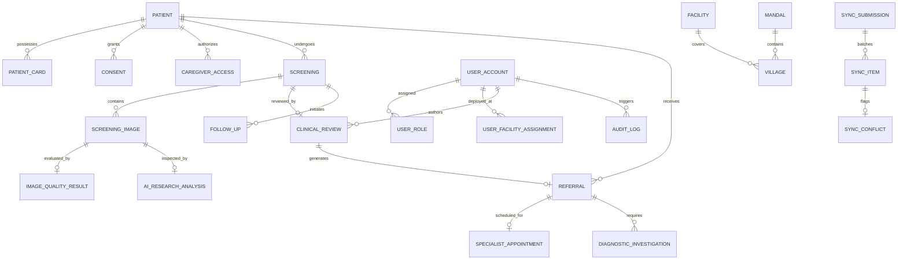

# AAROGYA DRISHTI — Backend Architecture Specification
**Document Version:** 1.0.0 (Phase 0 Architecture Specification)  
**System:** AAROGYA DRISHTI Community Healthcare Platform (ఆరోగ్య దృష్టి)  
**Architecture Pattern:** Modular Monolith with Asynchronous Worker Segregation  
**Target Pilot:** Alluri Sitharama Raju (ASR) District, Andhra Pradesh (ITDA Paderu)  

---

## 1. High-Level Architectural Topology

```
+--------------------------------------------------------------------------------------------------+
|                                    CLIENT APPLICATION TIER                                       |
|                                                                                                  |
|   +-------------------------------+   +-----------------------------+   +--------------------+   |
|   |   ASHA Frontline PWA (Android)|   |  Medical Officer Workstation|   |  Hospital / Admin  |   |
|   |   (IndexedDB Offline Storage) |   |  (Desktop Clinical Review)  |   |  (OPD / Analytics) |   |
|   +-------------------------------+   +-----------------------------+   +--------------------+   |
+--------------------------------------------------------------------------------------------------+
                                                 |
                                     HTTPS / WSS (REST / Bearer)
                                                 v
+--------------------------------------------------------------------------------------------------+
|                                API GATEWAY & REVERSE PROXY                                       |
|                  Nginx / Cloudflare (Rate Limiting, SSL Termination, Compression)                |
+--------------------------------------------------------------------------------------------------+
                                                 |
                                         /api/v1/* requests
                                                 v
+--------------------------------------------------------------------------------------------------+
|                           NESTJS MODULAR MONOLITH CORE BACKEND                                   |
|                                                                                                  |
|   [Global Middleware & Filters]                                                                  |
|   ├── CorrelationIdMiddleware • SecurityHeaders (Helmet) • GlobalHttpExceptionFilter             |
|   └── ResponseTransformInterceptor • ClassSerializerInterceptor • ThrottlerGuard                |
|                                                                                                  |
|   [Business Domain Modules]                                                                      |
|   ├── AuthModule (JWT, Argon2, MFA)              ├── DoctorReviewModule (Clinical Assessment)    |
|   ├── PatientsModule (Decoupled Identity)        ├── ReferralsModule (Specialist Dispatch)       |
|   ├── PatientCardsModule (QR Token Logic)        ├── AppointmentsModule (Hospital Scheduling)    |
|   ├── ConsentModule (Bilingual Purpose Scoping)  ├── InvestigationsModule (Biopsy Tracker)       |
|   ├── ScreeningModule (Habits & Trismus Intake)  ├── FollowUpModule (Community Recall)           |
|   ├── ImagesModule (S3 Storage Adapter)          ├── OfflineSyncModule (Idempotent Ingestion)    |
|   ├── ImageQualityModule (QA Coordinator)        ├── AdministrationModule (Coverage Analytics)   |
|   ├── AiResearchModule (Safety Isolation)        └── AuditModule (Tamper-Evident Access Logs)    |
|                                                                                                  |
|   [Data Access Layer]                                                                            |
|   └── PrismaService (PostgreSQL 16 Connection Pool, Type-Safe Client, Transaction Management)     |
+--------------------------------------------------------------------------------------------------+
           |                                   |                                     |
           | Database Queries                  | Asynchronous Jobs                   | Private Storage
           v                                   v                                     v
+-----------------------+           +----------------------+              +----------------------+
|     POSTGRESQL 16     |           |     REDIS 7+ /       |              |  PRIVATE OBJECT S3   |
|  (Relational Database,|           |       BULLMQ         |              | (MinIO / AWS S3)     |
|   ACID Transactions,  |           | (Job Queues, Caching,|              | (Encrypted at Rest,  |
|   Spatial PostGIS)    |           |  Sync Processing)    |              |  Presigned URLs)     |
+-----------------------+           +----------------------+              +----------------------+
                                               |
                               +---------------+---------------+
                               |                               |
                               v                               v
                +----------------------------+   +----------------------------+
                |    IMAGE QUALITY WORKER    |   |    AI RESEARCH SERVICE     |
                |    (Python 3.11 + OpenCV)  |   |    (Python 3.11 + FastAPI) |
                |  - Laplacian Focus Sharpness|  |  - Mock Research Adapter   |
                |  - Lighting / Glare Check  |   |  - score: null enforcement |
                |  - Resolution Validation   |   |  - strictly non-clinical   |
                +----------------------------+   +----------------------------+
```

---

## 2. Technology Stack & Architectural Decisions

### 2.1 Backend Runtime & Framework: NestJS + TypeScript
- **Decision:** NestJS was selected over Express or FastAPI for the core application tier.
- **Rationale:** 
  1. Enterprise-grade dependency injection (DI) ensures domain modules (e.g. `ConsentModule`, `ScreeningModule`, `DoctorReviewModule`) remain strictly decoupled.
  2. Automatic OpenAPI 3.0 / Swagger documentation via decorators (`@ApiProperty()`, `@ApiOperation()`).
  3. Declarative validation via `class-validator` and `class-transformer` guarantees strong request boundary protection before any service execution.

### 2.2 Database & ORM: PostgreSQL 16 + Prisma ORM
- **Decision:** PostgreSQL with Prisma ORM.
- **Rationale:**
  1. Relational integrity with foreign key constraints, cascade controls, and unique composite indexes is vital for patient safety and audit trails.
  2. Native JSONB support enables flexible storage of habit exposure profiles and multi-stage screening forms without schema churn.
  3. PostGIS integration supports geographic habitation coverage polygons for the ITDA Paderu tribal agency.
  4. Prisma provides end-to-end type safety from database schema to TypeScript controllers.

### 2.3 Segregated Python Worker Micro-Services
- **Decision:** Separate Python processes for OpenCV image quality checks and AI research model inference.
- **Rationale:**
  1. Heavy scientific C-extensions (`numpy`, `opencv-python`, `torch`) should not run inside the Node.js V8 event loop.
  2. The AI research model is an exploratory component; isolating it behind a dedicated REST / BullMQ queue guarantees that an AI container failure or memory leak can **never** crash core patient registration, clinic queues, or offline sync operations.

---

## 3. Database Architecture & ER Blueprint

The database contains 26 core relational entities organized into 6 functional clusters:



### 3.1 Entity Inventory Summary

1. **Identity & Access:**
   - `UserAccount`: Authenticated system operators (ASHAs, Doctors, Hospital Staff, Admins).
   - `Role`: System role definitions (`HEALTH_WORKER`, `DOCTOR`, `SPECIALIST`, `HOSPITAL_STAFF`, `ADMIN`, `PATIENT`).
   - `UserRole`: Many-to-many relationship mapping users to roles.
   - `UserFacilityAssignment`: Restricts staff access to assigned Primary Health Centres (PHCs) or District Hospitals.
   - `UserVillageAssignment`: Restricts frontline health workers to assigned habitations (e.g. Kothapalli, Nurmati).
   - `UserSession`: Tracks active refresh tokens, device IDs, and revokable sessions.

2. **Patient & Community Identity:**
   - `Patient`: Core patient demographic record. Decoupled from `UserAccount`.
   - `PatientCard`: Physical health cards with non-sensitive QR token references.
   - `PatientCardHistory`: Audit log of replaced or revoked card serials.
   - `CaregiverAccess`: Family member proxy permissions with documented authorization basis.
   - `Consent`: Bilingual informed consent records with purpose flags and witness details.

3. **Frontline Screening & Imaging:**
   - `Screening`: Doorstep oral health screening session with tobacco/gutkha habit metrics.
   - `ScreeningImage`: Metadata for 5 standardized views (Right Cheek, Left Cheek, Tongue, Palate, Gums).
   - `ImageQualityResult`: OpenCV quality validation metrics (Laplacian blur, lighting, glare).
   - `AIResearchAnalysis`: Strictly non-clinical demonstration output (`score: null`, research labels).

4. **Clinical Triage & Specialist Care:**
   - `ClinicalReview`: Independent physical assessment signed by human clinician with APMC registration number.
   - `Referral`: Official hospital referral with urgency classification (`URGENT_72H`, `HIGH_2W`, `ROUTINE`).
   - `SpecialistAppointment`: District Hospital OPD clinic bookings.
   - `DiagnosticInvestigation`: Punch biopsy tracking through 5 laboratory stages.
   - `FollowUp`: Community doorstep recall tasks for habit cessation and post-referral tracking.

5. **Offline Synchronization:**
   - `SyncSubmission`: Batch wrapper with client UUID and idempotency key.
   - `SyncItem`: Individual record operation within an offline batch.
   - `SyncConflict`: Divergent client vs server records flagged for authorized resolution.

6. **Governance & Accountability:**
   - `AuditLog`: Tamper-evident log of all Protected Health Information (PHI) reads, writes, and exports.
   - `SystemEvent`: Infrastructure telemetry, edge heartbeats, and gateway status.
   - `InAppNotification`: Role-scoped operational alerts.

---

## 4. Multi-Tier Security & Authorization Architecture

### 4.1 Principle of Least Privilege
Security is enforced on every single REST endpoint via layered NestJS guards:

```
Incoming Request
       │
       ▼
[JwtAuthGuard] ─── Verifies cryptographic signature & session revocation
       │
       ▼
[RolesGuard] ───── Checks if role has permission for endpoint category
       │
       ▼
[FacilityScopeGuard] ─ Ensures user belongs to the facility owning the record
       │
       ▼
[VillageScopeGuard] ── Ensures health worker is assigned to patient's habitation
       │
       ▼
Route Handler Execution
```

### 4.2 Patient Privacy & Non-Sensitive QR Tokens
- In accordance with the Indian Digital Personal Data Protection (DPDP) Act:
  - The QR code on physical health cards contains **only** a random opaque token: `AAROGYA-DRISHTI://CARD-REF/ASR-PAT-2026-0842/EMERGENCY-VERIFY`.
  - Scanning the QR code without authenticated frontline login displays zero health data.
  - Authorized health workers must authenticate and pass village scoping before the patient record can be retrieved.

### 4.3 Private S3 Object Storage Workflow
- Medical oral photographs are never stored in public buckets or stored directly in PostgreSQL:
  1. Client requests presigned upload URL via `POST /api/v1/screenings/:id/images/upload-init`.
  2. Backend verifies active consent and generates a randomized storage key: `screenings/{screeningId}/{viewKey}_{uuid}.jpg`.
  3. Image binary is uploaded to private S3 bucket with server-side AES-256 encryption.
  4. Backend inspects file headers (magic bytes) to reject spoofed files.
  5. Read access is restricted via 15-minute time-limited presigned GET URLs generated only for authorized clinicians.

---

## 5. Offline Synchronization State Machine & Idempotency Strategy

```
[Frontline Tablet]                 [Central NestJS Server]
        │                                     │
        │ 1. Collects screenings offline      │
        │    Generates client UUIDs           │
        │                                     │
        │ 2. Network Restored                 │
        │    POST /api/v1/sync/batch          │
        │    Headers: X-Idempotency-Key       │
        ├────────────────────────────────────>│
        │                                     │ 3. Check Idempotency Key in Redis/DB
        │                                     │    - If previously processed:
        │                                     │      Return existing receipt
        │                                     │    - If new:
        │                                     │      Begin DB Transaction
        │                                     │      Process items
        │                                     │      Detect conflicts (version checks)
        │                                     │      Save SyncSubmission & SyncItems
        │                                     │      Commit Transaction
        │ 4. Return Server Acknowledgements   │
        │<────────────────────────────────────┤
        │                                     │
        │ 5. Mark local IndexedDB as SYNCED   │
        ▼                                     ▼
```

- **Idempotency Guarantees:** 
  - Retrying an interrupted sync batch using the same `submissionId` will never duplicate patient registrations or screenings.
  - The server verifies version stamps (`recordVersion`); if a conflict occurs, the server records a `SyncConflict` and returns explicit instructions rather than silently overwriting clinical records.
