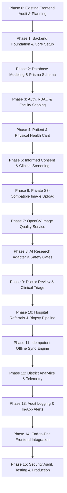

# AAROGYA DRISHTI — Backend Implementation Plan
**Project Title:** AAROGYA DRISHTI (ఆరోగ్య దృష్టి) — *Every Smile Deserves Care* | ప్రతి చిరునవ్వుకు ఆరోగ్య సంరక్షణ అవసరం  
**Target Pilot:** Alluri Sitharama Raju (ASR) District, Andhra Pradesh (ITDA Paderu)  
**Document Version:** 1.0.0 (Phase 0 Planning Baseline)  
**Architecture:** Production-Oriented Modular Backend (NestJS + Prisma + PostgreSQL + Redis + Python Services)  
**Status:** Phase 0 Complete — Awaiting Stakeholder & User Approval to Proceed to Phase 1  

---

## 1. Executive Summary & Core Engineering Philosophy

The **AAROGYA DRISHTI** backend is engineered to provide a secure, scalable, highly resilient, and privacy-preserving clinical data backbone for community oral healthcare and early cancer detection in rural and tribal habitations across the Eastern Ghats of Andhra Pradesh.

### Core Non-Negotiable Directives:
1. **Technology Reaches the Patient; The Patient Never Reaches Technology:**
   - Registration, doorstep screening, clinical triage, hospital referrals, and follow-up care must **never** be gated by a patient possessing a smartphone, mobile phone number, OTP, digital literacy, email, or user login account.
   - Patient identity (`Patient` entity) is completely decoupled from system authentication accounts (`UserAccount` entity).
   - A patient receives a durable physical **Health Card** with a non-sensitive identifier token (`AAROGYA-DRISHTI://CARD-REF/.../EMERGENCY-VERIFY`) that contains zero medical or clinical details in the QR code itself.

2. **Absolute Clinical Safety & Non-Diagnostic AI Boundaries:**
   - The AI research analysis service is an auxiliary, experimental prototype. It must **never** diagnose oral cancer, rule out cancer, reassure a patient that malignancy is absent, prescribe treatment, or autonomously dispatch referrals.
   - All AI research outputs must use categorical labels (`suspicious_example`, `benign_example`) with strictly `score: null` (prohibiting numerical cancer probabilities like *"94.2% chance"*).
   - The primary diagnostic and referral decisions are authored, signed, and time-stamped solely by qualified human Medical Officers (*Dr. K. Suresh, MBBS, APMC-48291*).
   - If the AI service is unreachable, degraded, or offline, patient screening, clinical review, and referral workflows proceed unhindered.

3. **Offline-First Resilience with Idempotency Guarantees:**
   - Frontline Community Health Workers (ASHAs / ANMs / CHOs) operate in remote tribal habitations without 4G/Wi-Fi.
   - The backend must accept client-generated UUIDs and unique submission idempotency keys to guarantee that retrying offline submissions never duplicates patient records or screenings.
   - Clinical conflicts must be explicitly recorded, versioned, and audited rather than silently overwritten.

4. **Multi-Tier Authorization (Role + Resource / Facility / Village Scoping):**
   - Possession of a role (e.g. `HEALTH_WORKER`, `DOCTOR`, `HOSPITAL_STAFF`) does **not** grant district-wide data access.
   - Access is strictly constrained by assigned facility, assigned mandal/villages, and legitimate clinician-patient care relationships.

---

## 2. Phased Implementation Roadmap (Phases 0 through 15)

To guarantee software reliability, clinical compliance, and zero regression against the completed frontend, backend delivery is structured into 16 sequential, verifiable phases:

### Detailed Phase Milestones & Deliverables

| Phase | Milestone Name | Key Engineering Deliverables | Verification & Exit Criteria |
|---|---|---|---|
| **Phase 0** | **Existing Frontend Audit & Planning** | Frontend sitemap inspection, mock schema mapping, `BACKEND_IMPLEMENTATION_PLAN.md`, `FRONTEND_BACKEND_MAPPING.md`, `BACKEND_ARCHITECTURE.md`, `BACKEND_TASK_TRACKER.md`. | Comprehensive audit report delivered; user approval gate before code writing. |
| **Phase 1** | **Backend Foundation & Toolchain** | NestJS modular monolith scaffold, TypeScript strict config, config validation (`@nestjs/config`), Swagger OpenAPI 3.0 docs, global exception filter, response envelope interceptor, structured Winston logger, health probe (`/health/liveness`, `/health/readiness`), Dockerfile & docker-compose. | NestJS boots, Swagger UI renders at `/api/docs`, health check returns HTTP 200. |
| **Phase 2** | **Database Modeling & Migrations** | PostgreSQL 16 setup, ER diagram, complete `schema.prisma` with 26 entities, relations, unique constraints, composite indices, foreign keys, baseline migration, synthetic seed script (`prisma/seed.ts`). | `prisma migrate dev` executes cleanly; seed script populates 5 roles & G. Madugula pilot data. |
| **Phase 3** | **Authentication & Multi-Tier Authorization** | JWT / Session auth, argon2 password hashing, MFA support, `JwtAuthGuard`, `RolesGuard`, `FacilityScopeGuard`, `VillageScopeGuard`, login rate limiting (`@nestjs/throttler`), secure audit events. | Unit & integration tests for unauthorized, cross-facility, and expired token access. |
| **Phase 4** | **Patient Management & Health Card** | Registration without phone/account, unique Patient ID generator (`ASR-PAT-YYYY-XXXX`), duplicate warning engine, printable card issuance, cryptographic QR token generator (`AAROGYA-DRISHTI://CARD-REF/...`), card replacement & revocation. | Register patient with null phone; verify QR token discloses zero PHI. |
| **Phase 5** | **Informed Consent & Screening Intake** | Bilingual consent recording (verbal/witnessed/written), purpose scoping (screening, photos, research demo, referral), screening intake API with habit assessment (tobacco, reverse smoking) and trismus/patch symptoms. | Consent gate rejects screening image upload if consent is missing or withdrawn. |
| **Phase 6** | **Secure Private Image Storage** | S3/MinIO private object storage adapter, MIME validation (magic numbers/file signatures), sanitized UUID object keys, time-limited presigned URLs, private bucket isolation, upload audit logging. | Reject fake MIME types / executables; zero public bucket exposure. |
| **Phase 7** | **OpenCV Image Quality Service** | Separate Python/FastAPI micro-worker, Laplacian variance blur detection, histogram exposure checking, specular glare rejection, resolution validation, structured quality DTO (`ACCEPTABLE`, `RECAPTURE_REQUIRED`). | Blur & underexposure test images correctly trigger `RECAPTURE_REQUIRED`. |
| **Phase 8** | **AI Research Gateway & Safety Boundaries** | Isolated AI research adapter, BullMQ task queue, synthetic research inference engine, strict `score: null` enforcement, non-clinical disclaimer payload, service failure (HTTP 503) fallback. | Verify AI output never overwrites doctor fields; test workflow continuity when AI is offline. |
| **Phase 9** | **Doctor Clinical Review & Triage** | Medical Officer clinical review queue, longitudinal case inspector, independent physical observation form, cardinal signs checklist, specialist referral dispatch, digital signature stamp. | Review cannot be submitted without authenticated clinician; AI output remains isolated. |
| **Phase 10** | **Hospital Referral & Biopsy Pipeline** | Inbound referral intake, specialist OPD clinic scheduling, 5-stage biopsy tracking pipeline (`ADVISED` -> `SAMPLE_COLLECTED` -> `LAB_PROCESSING` -> `REPORT_READY` -> `REVIEWED`), tribal patient navigation touchpoint logger. | Complete hospital lifecycle status transitions verified. |
| **Phase 11** | **Idempotent Offline Sync Engine** | Batch synchronization endpoint (`POST /api/v1/sync/batch`), UUID idempotency key deduplication, server acknowledgement receipts, conflict detection engine, sync event audit log. | Simulated duplicate offline batch retry creates zero duplicate database records. |
| **Phase 12** | **District Administration & Analytics** | District aggregate metrics for ITDA Paderu, mandal/village screening coverage, habit prevalence breakdown (gutkha, reverse chutta smoking), edge gateway telemetry, CSV export streaming. | Aggregate APIs return zero identifiable individual PHI. |
| **Phase 13** | **Audit Logging & Notification System** | Tamper-evident audit logging for all PHI reads/writes, request correlation IDs, in-app notification dispatch (new referral, biopsy ready, follow-up recall). | Security audit logs verify user, action, resource, timestamp, and IP. |
| **Phase 14** | **Frontend Integration & E2E Validation** | Replace frontend mock services with typed Axios client, wire Auth, Sync, Camera, Doctor Triage, Hospital Desk, and Admin Dashboards to live NestJS APIs. | Full end-to-end Kondala Rao (46M, G. Madugula) patient journey executed successfully. |
| **Phase 15** | **Security Hardening, Testing & Handover** | Supertest E2E suites, Jest unit coverage (>80%), automated backup and restore runbook, Docker Compose production stack, all 14 backend handover documents. | Zero build/lint errors, all integration tests green, complete sign-off. |

---

## 3. Technology Stack & Component Justifications

| Tier | Technology | Purpose & Architectural Justification |
|---|---|---|
| **Runtime** | **Node.js 20+ LTS** | Proven asynchronous I/O performance, enterprise LTS stability. |
| **Framework** | **NestJS 10+** | TypeScript-first, modular architecture with dependency injection, DTO validation, and built-in OpenAPI integration. |
| **Database** | **PostgreSQL 16** | Robust relational ACID compliance, JSONB document support for flexible screening payloads, and spatial support (PostGIS) for tribal habitation mapping. |
| **ORM** | **Prisma 5+** | Type-safe database queries, schema-driven migrations, and declarative relation modeling. |
| **Cache & Queue** | **Redis 7+ / BullMQ** | High-throughput asynchronous background job queue for image quality checks, AI demo inference, and offline batch sync processing. |
| **Object Storage** | **MinIO / AWS S3** | Private S3-compatible object storage with server-side encryption (SSE-S3/KMS) and presigned URL access controls. |
| **Quality Engine** | **Python 3.11 + OpenCV** | Industry-standard Laplacian sharpness variance and lighting histogram evaluation. |
| **AI Research Engine**| **FastAPI + PyTorch / Mock** | Isolated research prototype running in a segregated container to prevent heavy ML dependencies from destabilizing core clinical services. |
| **Testing** | **Jest & Supertest** | Comprehensive unit, service, controller, and E2E HTTP integration test suites. |
| **Containerization**| **Docker & Docker Compose** | Multi-container reproducible development and staging environment with isolated network bridges. |

---

## 4. Phase 0 Acceptance & Next Steps

This document establishes the strategic implementation roadmap. Upon user approval, work will immediately begin with **Phase 1: Backend Foundation & Toolchain**.
