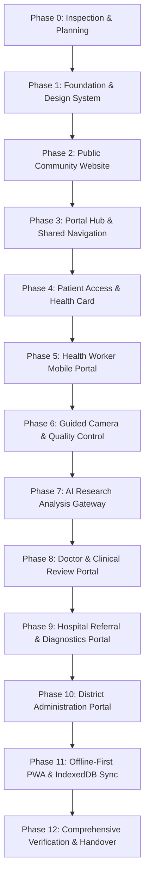

# AAROGYA DRISHTI — Frontend Implementation Plan
**Project Vision:** *Every Smile Deserves Care* | ప్రతి చిరునవ్వుకు ఆరోగ్య సంరక్షణ అవసరం  
**Target Pilot:** Alluri Sitharama Raju District, Andhra Pradesh (ITDA Paderu)  
**Document Version:** 1.0.0 (Phase 0 Planning)  
**Status:** Under Review / Awaiting User Approval to Proceed to Phase 1

---

## 1. Executive Summary & Product Objective
AAROGYA DRISHTI is a community oral healthcare and early cancer detection facilitation platform engineered specifically for rural and tribal communities. 

### Core Philosophies:
1. **Technology reaches the patient; the patient never has to reach technology.**
   - No patient is denied access or care due to lack of a smartphone, mobile phone number, OTP, digital literacy, internet connectivity, or user account.
   - Primary care pathway is **Assisted Frontline Access** through authorized Community Health Workers (ASHA / ANM / Community Mobilizers).
   - Patients receive durable physical **AAROGYA DRISHTI Health Cards** equipped with non-sensitive identifier QR codes for continuity of care.
   - An **Optional Patient Portal** and **Authorized Caregiver Access** are provided for digital-literate households and family caregivers.

2. **Absolute Clinical Safety & Transparent AI Boundaries:**
   - Frontline image analysis models are **strictly non-clinical research / demonstration prototypes**.
   - The platform will **never** diagnose oral cancer, rule out disease, reassure that cancer is absent, or autonomously generate prescriptions or referrals.
   - Frontline photography supplements, but never replaces, direct clinical physical examination.
   - The Doctor / Medical Officer conducts an independent review and signs all clinical findings and referral decisions.
   - The basic screening, review, referral, and follow-up workflows continue reliably even if AI services are unavailable or offline.

---

## 2. Phased Development Roadmap

The platform is designed to be developed strictly in sequential, verifiable phases.

### Phase Breakdown

| Phase | Milestone | Key Deliverables | Verification Strategy |
|---|---|---|---|
| **Phase 0** | Inspection & Planning | Repository assessment, architecture docs, design system specs, route map, task tracker | User review and approval gate |
| **Phase 1** | Foundation & Design System | Vite + React + TypeScript scaffold, TailwindCSS + Nature Theme tokens, Noto Sans Telugu typography, reusable primitives (Button, Card, Badge, Modal, Input, Table, Alert, StatCard), Design System showcase | Build and lint check, responsive mobile/desktop inspection |
| **Phase 2** | Public Community Website | Bilingual header, Hero ("Every Smile Deserves Care"), About, Oral Anatomy & Health, Warning Signs & Cancer Awareness, Healthy Habits, How It Works (Village to Hospital flow), Facilities Directory, FAQ, Community Footer | Language switcher verification (EN/TE), zero text overflow on mobile, accessibility contrast check |
| **Phase 3** | Portal Hub & Shared Navigation | Role-selection portal gateway, demo account switchers (Health Worker, Doctor, Specialist, Hospital Coordinator, District Admin, Patient), deep green nature sidebar, responsive mobile drawer, breadcrumbs, user profile header | Route guards, role switcher test, mobile drawer touch gestures |
| **Phase 4** | Patient Access & Health Card | Assisted Access guide, Printable Physical Patient Health Card (front/back with non-sensitive QR), lost-card workflow, optional patient portal (screenings, appointments, care journey, family caregiver permission management) | Print preview stylesheet check, QR token isolation verification, Caregiver revoke simulation |
| **Phase 5** | Health Worker Portal | Field dashboard (assigned tribal villages, stats, activity map, weekly screening graph, pending tasks), patient registration (no mandatory phone, duplicate warning UI), informed bilingual consent modal, clinical intake checklist | Responsive Android layout, duplicate name detection dialog, screening form validation |
| **Phase 6** | Guided Camera & Image Quality | Camera capture + gallery file input, 5 guided oral views (cheeks, tongue, palate, gums, floor of mouth), on-screen framing overlay, image quality analyzer mock (blur, underexposure, glare, resolution), recapture feedback | Low-light / blurred test image rejection, clear user instructions in Telugu/English |
| **Phase 7** | AI Research Demonstration | Non-clinical AI pipeline adapter, 5 processing stages, structured output display (`research_label`, `model_version`, `requires_clinician_review: true`, `warning: NOT FOR CLINICAL USE`), AI service failure graceful fallback | Resilient UI check when AI is unavailable, zero fabricated cancer probabilities |
| **Phase 8** | Doctor & Medical Officer Portal | Triage queue of submitted cases, longitudinal case viewer, zoomable photo inspection, isolated AI research panel, independent clinical observation form, referral generator, telemedicine consultation preview | Complete clinical review flow without AI prefill, signature timestamping |
| **Phase 9** | Hospital & Diagnostics Portal | Referral intake list, appointment scheduling & status tracking, patient coordination logs, diagnostic investigation tracker (biopsy/histopathology/imaging simulation) | Status machine validation (`REQUESTED` to `COMPLETED`), coordination note logging |
| **Phase 10** | District Administration Portal | District-wide aggregate dashboard (ITDA Paderu, ASR District), mandal/village filter, screening coverage trends, health worker activity, hospital referral completion rate, offline sync health | Zero individual PHI on district aggregate maps, chart responsiveness |
| **Phase 11** | Offline-First PWA & IndexedDB | Web App Manifest, Service Worker caching, local IndexedDB draft storage, synchronization status indicator (`Saved Locally`, `Syncing`, `Synced`, `Conflict`), manual sync retry | Airplane mode test: draft creation, app refresh, data persistence, network reconnect sync |
| **Phase 12** | Testing, Audit & Handover | Comprehensive test suites, end-to-end journey validation (G. Madugula 46-yo synthetic scenario), test report, known limitations, developer handover documentation | `npm run test`, `npm run build`, full checklist sign-off |

---

## 3. Synthetic Demo Scenario for End-to-End Validation
As specified in the AAROHAN Hackathon specifications, all testing and live demonstrations use the standardized reference scenario:

- **Patient Name:** Kondala Rao (Synthetic)
- **Age / Sex:** 46 / Male
- **Residence:** G. Madugula village, Alluri Sitharama Raju District
- **History:** Long-term chewing tobacco / gutkha usage
- **Complaint:** Persistent white patch on inner right cheek (> 3 weeks duration)
- **Frontline Flow:** Registered by Health Worker -> Consent captured -> Guided photos taken -> Image quality checked -> AI research flag recorded -> Synced -> Medical Officer reviews and requests hospital referral -> District hospital books appointment -> Simulated biopsy tracking -> Patient navigator follows up.

---

## 4. Phase 0 Acceptance & Approval Request
This implementation plan establishes the architectural guardrails, milestones, and safety constraints. Upon review and user approval, execution will commence immediately with **Phase 1: Foundation and Design System**.
